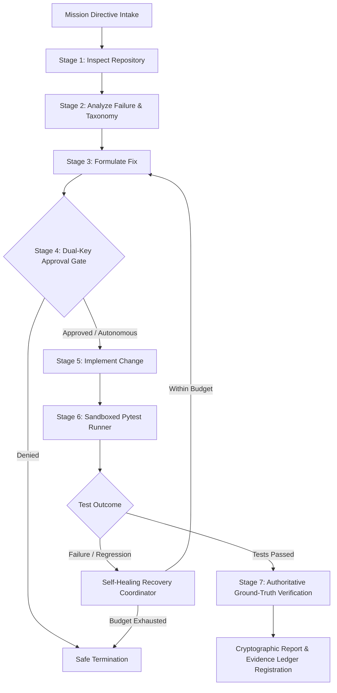

# ORION System Architecture Specification

**Release:** `1.0.0`  
**Classification:** Autonomous AI Software Engineering Operating System  
**Runtime:** 100% Python Standard Library (3.12+) // Zero Third-Party Runtime Dependencies  

---

## 1. System Overview & Core Philosophy

ORION is an authoritative, deterministic, and evidence-backed Autonomous Software Engineering (SWE) platform. It coordinates specialized agents to formulate, implement, verify, and self-heal complex code modifications across real codebases.

Unlike naive generative chatbot loops that run open-ended `while not solved` cycles, ORION subjects all proposals, repository operations, tool invocations, and test evaluations to strict, deterministic stage gates:

---

## 2. Deterministic 7-Stage Pipeline

Every engineering mission advances through a canonical, deterministic task graph:

1. **INSPECT_REPOSITORY:** Explores directory structure, identifies existing test suites, maps imports, and captures pre-mutation repository state.
2. **ANALYZE_FAILURE:** Executes baseline tests, parses tracebacks, and classifies defects into formal failure taxonomy categories.
3. **FORMULATE_FIX:** Synthesizes targeted patch proposals restricted strictly to localized target files identified in the blast radius.
4. **APPROVAL_GATE:** Evaluates the `PolicyEngine` rules. In Controlled Execution Mode, requires single-use cryptographic operator authorization before applying changes to disk.
5. **IMPLEMENT_CHANGE:** Captures pre-patch recovery points via `PatchRecoveryManager`, verifies SHA-256 state locks, and applies unified diffs with atomic rollback safety.
6. **RUN_TESTS:** Executes bounded `pytest` subprocesses with `shell=False` isolation, strict timeout enforcement, and comprehensive exit code evaluation.
7. **VERIFY:** Authoritative `VerificationEngine` independently audits ground-truth criteria (zero regressions, assertions satisfied, evidence verified). Passes advance to certified report generation; failures route to self-healing recovery.

---

## 3. Specialized Multi-Agent Workforce

ORION separates responsibilities into four distinct technical agents governed by role-based capability boundaries:

| Agent Role | Code | Primary Responsibility | Permission Tier | Permitted Tools |
| :--- | :--- | :--- | :--- | :--- |
| **SWE Engineer** | `SWE` | AST-aware code transformations and minimal blast-radius diff synthesis | `CONTROLLED` | `read_file`, `propose_patch`, `format_diff` |
| **Diagnostics Specialist** | `DX` | Traceback analysis, AST caller/callee graphs, and failure taxonomy classifier | `READ_ONLY` | `inspect_ast`, `trace_symbol`, `test_scope` |
| **Verifier Authority** | `VF` | Authoritative ground-truth verification; evaluates test assertions independently | `AUTHORITATIVE` | `run_pytest`, `evaluate_spec`, `certify_output` |
| **Recovery Coordinator** | `RC` | Self-healing supervisor with bounded budgets and non-destructive simulations | `CONTROLLED` | `rollback_diff`, `simulate_fix`, `escalate_hitl` |

---

## 4. Security & Containment Boundaries

ORION is governed by 20 non-negotiable security invariants (detailed in [`SECURITY.md`](file:///c:/Users/LIKITH/ORION/SECURITY.md)):

- **Filesystem Containment:** Every path operation verifies `resolved_path.is_relative_to(canonical_repo_root)`. Path traversal attempts (`../`), UNC paths, and Windows device names are rejected with `403 FORBIDDEN_PATH`.
- **Symlink & Junction Traversal:** Symlinks and directory junctions are followed to their physical targets and validated against workspace containment boundaries.
- **Subprocess Isolation:** Zero occurrences of `shell=True`. All commands run as explicit argument sequences (`list[str]`) with sanitized environment dictionaries and strict timeout limits.
- **Dual-Key Approval Tokens:** Single-use cryptographic approval tokens validate operator authorization. Attempted token reuse raises `PermissionError` and fails closed.
- **Secret Redaction:** High-entropy credentials, private keys, and `.env` contents are dynamically redacted to `[REDACTED]` before entering diffs, traces, or ledgers.

---

## 5. Epistemic Evidence Ledger & Verification Authority

ORION enforces the epistemological principle: **"Execution is not success; verified execution is success."**

The platform maintains an immutable, append-only `EvidenceLedger` tracking claims across three formal epistemic tiers:
- **Claimed:** Proposed changes, patch hypotheses, and agent formulations.
- **Observed:** Subprocess exit codes, file write timestamps, and AST parse results.
- **Verified:** Ground-truth facts independently certified by `VerificationEngine`.

Untrusted generative models cannot declare mission victory or manipulate verification outcomes.

---

## 6. Self-Healing Recovery Architecture

When test execution or verification fails, the `RecoveryCoordinator` takes control under strict bounded budgets:
- **Attempts Budget:** Maximum 3 recovery attempts per mission.
- **Time Budget:** Maximum 120 seconds total recovery runtime.
- **Patch Budget:** Maximum 2 patch regenerations before escalation.

### Recovery Strategies
The system selects from a closed set of deterministic recovery strategies:
- `CHANGE_TOOL`: Selected when a tool produces broken output or unexpected EOF.
- `CHANGE_MODEL`: Selected when a model enters a repetitive loop.
- `RETRY_CURRENT_TASK`: Selected upon transient test runner crash or timeout.
- `ROLLBACK`: Selected when a patch introduces test regressions, restoring clean pre-mutation state via `PatchRecoveryManager`.

---

## 7. Distributed Observability & Telemetry

Distributed telemetry correlates execution across all hierarchical layers:
`Mission -> Task -> Agent -> Tool/Model -> Verification`.

Key observability features include:
- **Distributed Spans:** End-to-end trace waterfall visualizer with unique trace IDs (`trc-xxxxxxxx`).
- **Latency Quantiles:** Automated P50, P90, and P99 span duration tracking.
- **Bottleneck Detection:** Automated identification of slow subroutines and I/O stalls.
- **Token Cost Accounting:** Token usage tracking across prompts and completions with simulated cost modeling.
