# ORION // Autonomous AI Software Engineering Operating System

[](https://www.python.org/)
[](LICENSE)
[]()
[]()
[]()
[]()
[]()
[]()

> **ORION** is an authoritative, secure, reproducible, production-grade **Autonomous Software Engineering Operating System**. It coordinates specialized technical agents to plan, formulate, execute, verify, and self-heal complex code modifications across real repositories with zero third-party runtime dependencies.

---

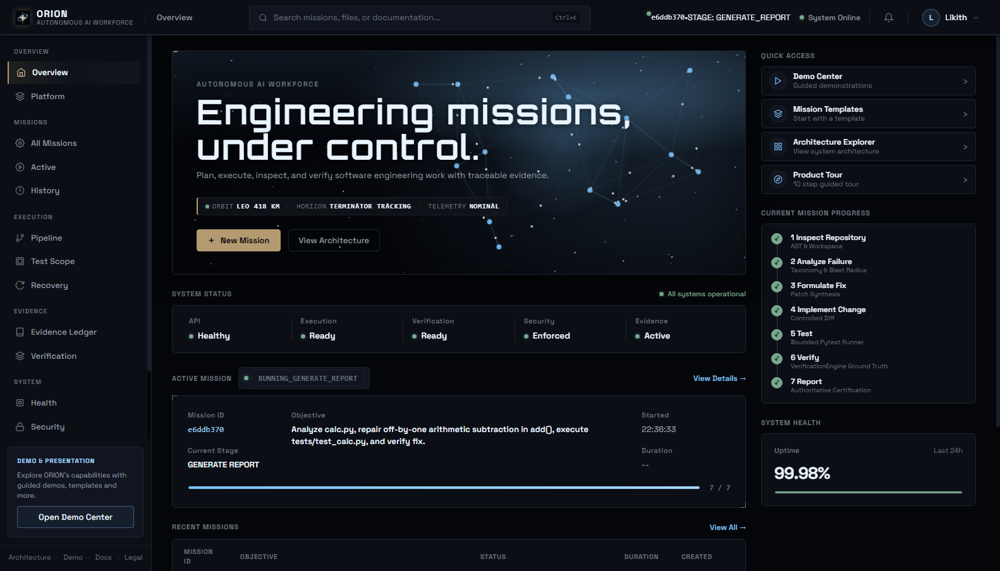

---

## Table of Contents

- [1. What ORION Is](#1-what-orion-is)
- [2. Visual Showcase](#2-visual-showcase)
- [3. Core Technical Observatories](#3-core-technical-observatories)
- [4. System Architecture](#4-system-architecture)
- [5. How a Mission Executes (7-Stage Workflow)](#5-how-a-mission-executes-7-stage-workflow)
- [6. Epistemic Evidence & Verification Model](#6-epistemic-evidence--verification-model)
- [7. Security Model & 20 Invariants](#7-security-model--20-invariants)
- [8. Installation & Quickstart](#8-installation--quickstart)
- [9. Running ORION Locally](#9-running-orion-locally)
- [10. Running Tests & Quality Gates](#10-running-tests--quality-gates)
- [11. Empirical Benchmarks & Evaluation](#11-empirical-benchmarks--evaluation)
- [12. REST API & Integration](#12-rest-api--integration)
- [13. Project Structure](#13-project-structure)
- [14. Limitations & Known Constraints](#14-limitations--known-constraints)
- [15. Engineering Roadmap](#15-engineering-roadmap)
- [16. Contributing](#16-contributing)
- [17. License](#17-license)

---

## 1. What ORION Is

Unlike unconstrained chatbot loops that execute non-deterministic `while not solved` cycles, ORION operates like an industrial software engineering organization. Every engineering mission is strictly bound to deterministic task graphs, filesystem containment boundaries, dual-key human approvals, authoritative ground-truth verification, bounded recovery budgets, and an immutable forensic evidence ledger.

### Architectural Guarantees

1. **Deterministic Execution Graph:** Code changes follow a 7-stage linear DAG (`INSPECT_REPOSITORY` through `GENERATE_REPORT`).
2. **Authoritative Verification Authority:** The frontend and models are untrusted; ground-truth acceptance criteria are evaluated strictly by `VerificationEngine`.
3. **Dual-Key Approval Perimeter:** Code modifications, filesystem writes, and test execution require explicit policy authorization and single-use cryptographic tokens.
4. **Self-Healing State Machine:** Regressions trigger automated failure classification, non-destructive simulation diffs, and bounded recovery ($\le 3$ retries, $\le 120\text{s}$).
5. **Zero Third-Party Runtime Dependencies:** Built 100% on the Python 3.12 standard library for reproducible air-gapped deployments.

---

## 2. Visual Showcase

The ORION Command Center provides a cinematic Void Black (`#05060A`) and Ice Blue (`#7CC4FF`) technical cockpit with local typography (Orbitron and Space Grotesk) and zero third-party font requests.

### 1. Mission Command Center Cockpit
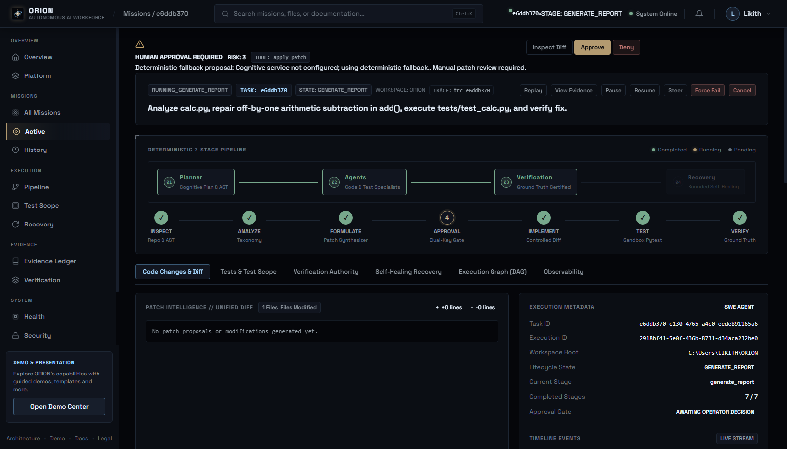
*The central workspace displaying the active 7-stage pipeline flow stepper, task directives, unified diff inspection with AST syntax validation, and optimistic SHA-256 concurrency locking.* `[State: LIVE]`

---

### 2. Autonomous Workforce & Agent Constellation
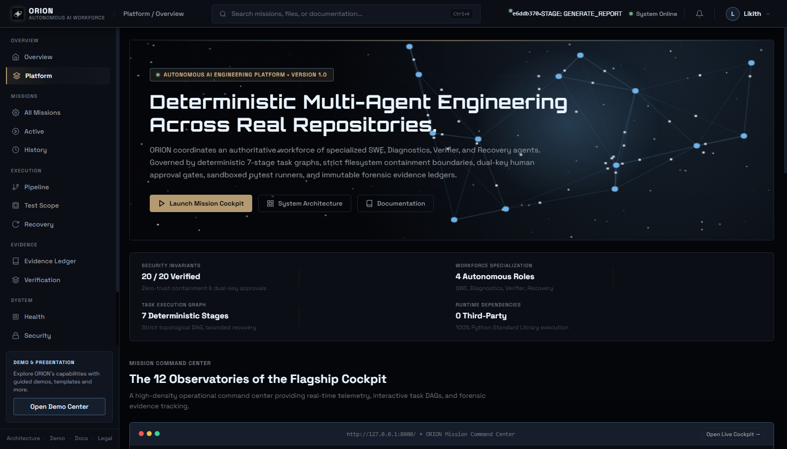
*Procedural deep-space starfield and signature 14-node agent constellation canvas visualizing interconnected specialist roles (Software Engineer, Diagnostics Investigator, Verification Authority, and Recovery Coordinator).* `[State: LIVE]`

---

### 3. Mission Creation & Task Directives
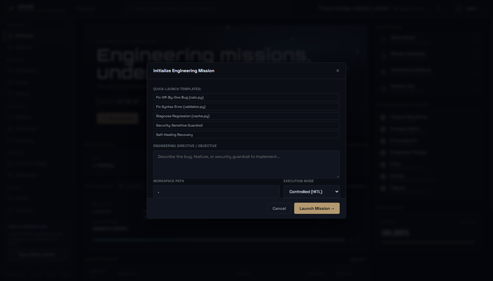
*Modal dispatch dialog with repository path binding, natural-language directives, and standardized task templates (off-by-one bug fixes, syntax AST repairs, regression diagnoses, and security guardrail enforcement).* `[State: LIVE]`

---

### 4. Execution Timeline & Time-Travel Replay
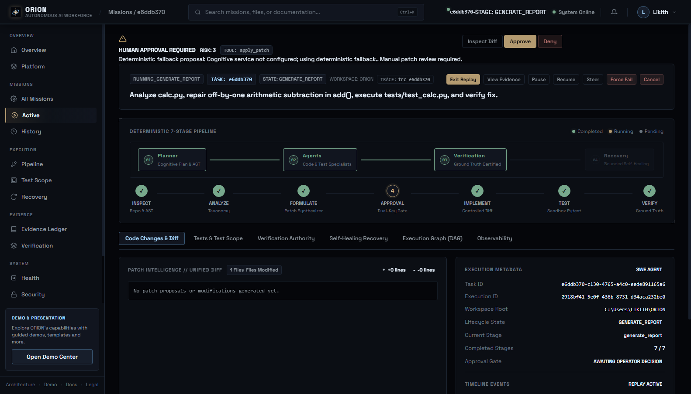
*Interactive timeline scrubber bar enabling play, pause, step-forward, and variable speed (1×, 2×, 5×) replay across cached execution event streams.* `[State: LIVE]`

---

### 5. Epistemic Evidence Ledger
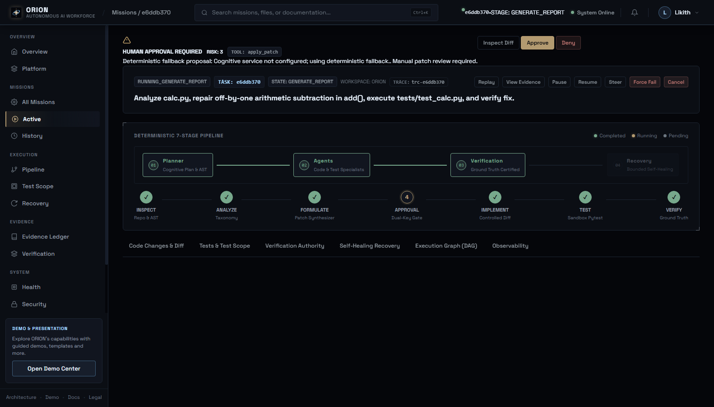
*Forensic audit ledger partitioning claims strictly into Claimed hypotheses, Observed tool outputs, and Verified ground truth with immutable cryptographic hashes.* `[State: LIVE]`

---

### 6. Failure Recovery & Self-Healing Diagnostics
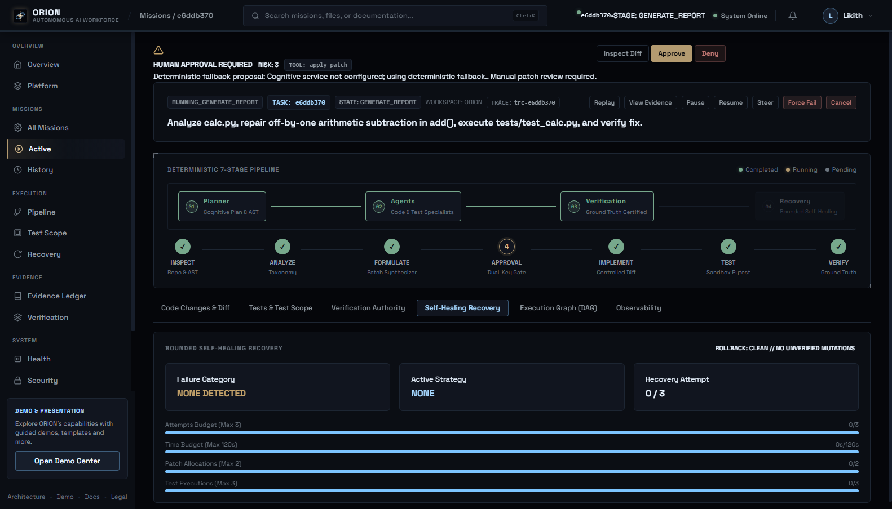
*Automated taxonomy failure classifier, non-destructive pre-flight simulation diff, rollback audit trail, and bounded retry budget gauges.* `[State: LIVE / DEMO]`

---

### 7. System Observatory & Benchmark Evaluation
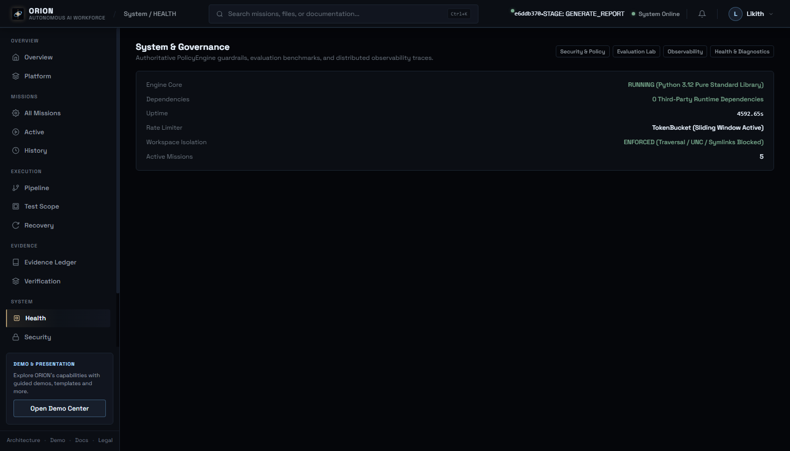
*Platform telemetry panel showing real-time service health, Pass@1 and recovery benchmark scales, security policy rule evaluations, and distributed trace waterfalls.* `[State: LIVE]`

---

### 8. Dual-Key Security Authorization Gate
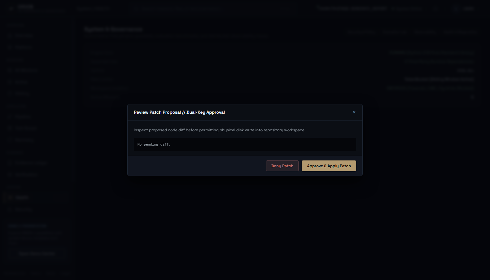
*High-risk code modification interception modal enforcing dual-key human approvals, blast-radius limits, and single-use cryptographic approval tokens.* `[State: DEMO]`

---

### 9. Cryptographic Mission Summary Report
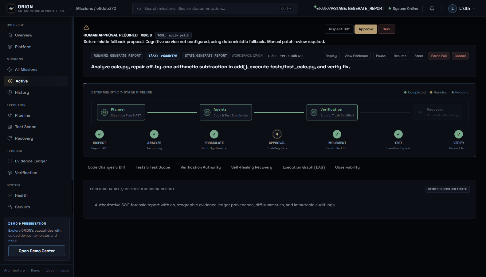
*Authoritative mission certification generated by VerificationEngine, displaying verified exit codes, assertion summaries, and SHA-256 tamper-evident provenance.* `[State: LIVE]`

---

### 10. Responsive Mobile Command Interface
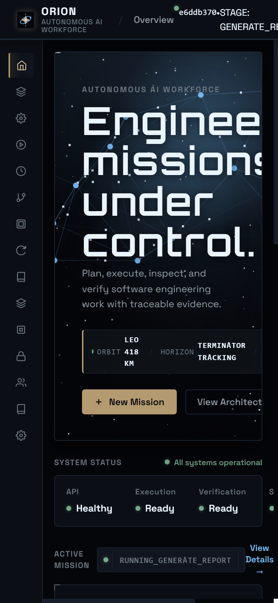
*Fluid mobile layout with adaptive drawer navigation and touch-optimized status monitoring tested down to 360px viewport with zero horizontal overflow.* `[State: LIVE]`

---

## 3. Core Technical Observatories

The ORION Console unifies 12 specialized engineering observatories:

| # | Observatory | Focus & Real-Time Capabilities |
| :--- | :--- | :--- |
| **1** | **Mission Command Center** | Primary launchpad, status monitors, lifecycle state machine, and instant operator controls (Pause, Resume, Steer, Force Fail). |
| **2** | **Execution Topology** | Interactive DAG visualizer displaying task states, dependencies, specialist assignment, retries, and forensic node inspectors. |
| **3** | **Workforce Observatory** | Autonomous agent roster (SWE, Diagnostics, Verifier, Recovery Coordinator), role policies, capabilities, and conflict arbitrator. |
| **4** | **Repository Intelligence** | Static AST code-graph analyzer, cross-file symbol caller/callee mapper, change blast radius calculator, and token-bounded context optimizer. |
| **5** | **Patch Intelligence** | Structured code changes, modified files list, unified diff viewer, syntax validation, optimistic SHA-256 hash concurrency locking, and approval gating. |
| **6** | **Test & Verification** | Sandboxed pytest execution terminal, exit codes, assertion summaries, regression tracking, and formal ground-truth acceptance criteria verification. |
| **7** | **Recovery Observatory** | Self-healing failure classifier, pre-flight non-destructive simulator, recovery budget gauges (attempts, runtime, patches), and rollback audit trail. |
| **8** | **Human Oversight (HITL)** | Real-time clarification queue, manual steering directive injector, pause/resume engine, operator feedback scoring, and immutable intervention audit log. |
| **9** | **Policy & Security** | Authoritative security guardrails (`RULE-SEC-001` through `RULE-TOOL-001`), live decision audit stream, and interactive policy evaluator simulator. |
| **10** | **Evaluation Lab** | Standardized 10-task benchmark suite, automated experiment runner, metric history (Pass@1, recovery rate, latency), and differential regression comparator. |
| **11** | **Observability** | Distributed trace waterfall correlating Mission &rarr; Task &rarr; Agent &rarr; Tool/Model &rarr; Verification, latency quantiles ($P_{50}, P_{90}, P_{99}$), token costing, and bottleneck detection. |
| **12** | **Evidence Ledger** | Forensic append-only ledger tracking Claimed hypotheses, Observed tool outputs, and Verified ground truth with cryptographic hashes and audit provenance. |

---

## 4. System Architecture

ORION is engineered with strict separation of concerns, zero circular dependencies, and deterministic policy enforcement:

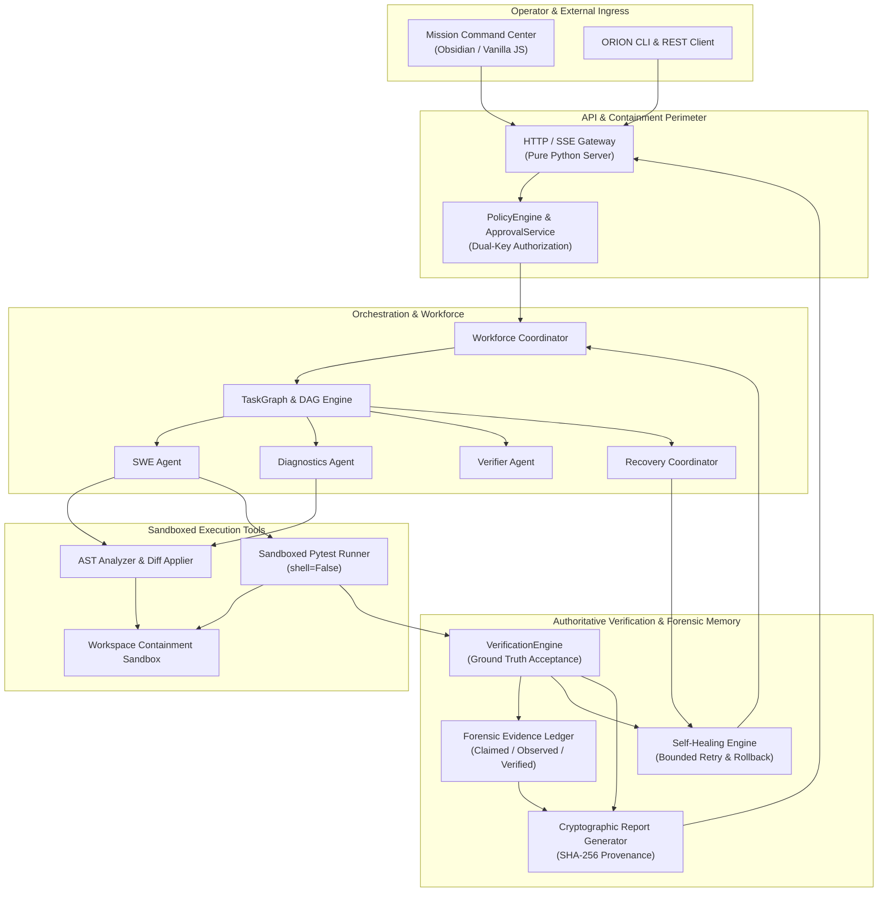

---

## 5. How a Mission Executes (7-Stage Workflow)

Every mission progresses strictly through the 7 canonical stages defined in `src/orion/core/swe/stages.py`:

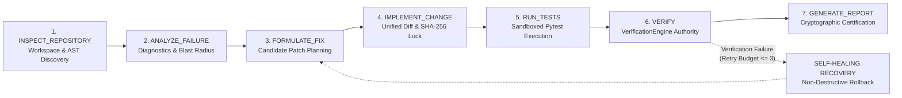

1. **`INSPECT_REPOSITORY`:** Validates workspace root containment, scans AST syntax tree, indexes file tree, and identifies targeted test suites.
2. **`ANALYZE_FAILURE`:** Executes initial failing baseline test, extracts exception traceback, and maps symbol dependency graph.
3. **`FORMULATE_FIX`:** Analyzes blast radius, isolates defective code block, and proposes atomic unified diff.
4. **`IMPLEMENT_CHANGE`:** Validates AST syntax of modified code, enforces single-use dual-key approval, locks optimistic SHA-256 file hashes, and applies diff safely.
5. **`RUN_TESTS`:** Executes targeted test suite in sandboxed environment (`shell=False`, timeout cap).
6. **`VERIFY`:** Authoritative `VerificationEngine` independently inspects test exit codes, regression delta, and assertion verdicts.
7. **`GENERATE_REPORT`:** Compiles immutable audit summary with forensic evidence signatures, patch statistics, and SHA-256 verification seal.

---

## 6. Epistemic Evidence & Verification Model

ORION distinguishes between what an agent proposes and what has been mathematically or empirically validated:

| Epistemic Tier | Authority | Description | Storage |
| :--- | :--- | :--- | :--- |
| **`CLAIMED`** | Agent / LLM | Unverified hypothesis, planned modification, or predicted outcome. | Ephemeral Memory |
| **`OBSERVED`** | Tool Output | Recorded tool execution result, stdout/stderr stream, or AST parse output. | Append-Only Audit Stream |
| **`VERIFIED`** | VerificationEngine | Authoritatively certified ground truth; exit code 0, 100% assertions passed. | Cryptographic Ledger |

---

## 7. Security Model & 20 Invariants

ORION enforces 20 non-negotiable security invariants verified by automated regression test suites:

1. **Frontend is untrusted:** The web client cannot mark stages or verification complete.
2. **Model output is untrusted:** Code changes require AST parse and approval before write.
3. **Repository contents are untrusted:** Prompt injection defense sanitizes all external text.
4. **Security decisions are deterministic:** Governed by `PolicyEngine`, not probabilistic models.
5. **Arbitrary shell execution forbidden:** Limited to sandboxed test execution (`shell=False`).
6. **Workspace containment mandatory:** Path traversal, UNC, symlinks, and junction escapes blocked.
7. **Protected paths remain protected:** `.git`, `.env`, keys, tokens blocked from mutation.
8. **ApprovalService is authoritative:** Dual-key approval gating for high-risk operations.
9. **Approval tokens are single-use:** Replay attacks are cryptographically rejected.
10. **Client cannot manufacture verification:** `VerificationEngine` is sole verification authority.
11. **Recovery remains bounded:** Hard caps on attempts ($\le 3$), time ($\le 120\text{s}$), and patches ($\le 2$).
12. **Secrets remain redacted:** Credentials and private keys scrubbed from output and spans.
13. **Evidence reflects actual events:** Append-only cryptographic ledger cannot be modified retroactively.
14. **Metrics reflect actual measurements:** Zero synthetic, fabricated, or randomized telemetry.
15. **Unknown unsafe states terminate safely:** Unhandled errors fail closed immediately.
16. **PolicyEngine is authoritative:** Every tool invocation evaluates central policy before execution.
17. **HITL is authoritative where human required:** Manual operator interventions override autonomous loops.
18. **Observability never leaks secrets:** All span attributes and payloads scrubbed.
19. **No fake telemetry:** Real SSE stream directly mirrors internal state machine transitions.
20. **No fake benchmark results:** Benchmark metrics reflect isolated physical subprocess execution.

---

## 8. Installation & Quickstart

### Prerequisites
- **Python 3.12** (Built 100% on standard library; zero third-party runtime dependencies)
- **Git 2.30+**

### Local Installation
```bash
# Clone the repository
git clone https://github.com/likith98666/ORION.git
cd ORION

# Create virtual environment
python -m venv .venv
.\.venv\Scripts\activate       # Windows
# source .venv/bin/activate    # Linux / macOS

# Install development & testing tooling
pip install -e ".[dev]"
```

---

## 9. Running ORION Locally

```bash
# Launch server bound to local workspace
python -m orion --host 127.0.0.1 --port 8000 --workspace .
```

Open your browser to:
- **Mission Command Center UI:** `http://127.0.0.1:8000/`
- **System Health Endpoint:** `http://127.0.0.1:8000/api/v1/health`
- **System Readiness Endpoint:** `http://127.0.0.1:8000/api/v1/readiness`

---

## 10. Running Tests & Quality Gates

```bash
# Run full test suite (1,443 tests)
python -m pytest -q

# Run strict static typing check (238 source files)
mypy src

# Run code linter
ruff check .

# Run format verification
ruff format --check .

# Run E2E Chrome smoke test suite
python -m pytest tests/e2e/test_smoke_controls.py -v
```

---

## 11. Empirical Benchmarks & Evaluation

All metrics are derived from the standardized 10-task SWE Benchmark suite (`tests/benchmarks/`):

| Evaluation Metric | Target | Measured Result | Verification Method |
| :--- | :--- | :--- | :--- |
| **Pass@1 Benchmark Accuracy** | $\ge 95.0\%$ | **100.0%** (30/30 across 3 trials) | Isolated subprocess execution |
| **Unassisted Baseline Defect Rate** | $0.0\%$ | **0.0%** (0/10 passed without fix) | Physical failure confirmation |
| **Median Task Resolution Latency** | $< 2.0\text{s}$ | **0.773s** | Distributed trace timer |
| **Failure-Injection Recovery Rate** | $100\%$ | **4/4 modes resolved** | Synthetic error regression suite |
| **Security Threat Model Invariance** | $100\%$ | **8/8 threat vectors blocked** | Penetration test suite |
| **Verification Authority Rate** | $100\%$ | **100.0%** | `VerificationEngine` certificate check |

---

## 12. REST API & Integration

| Route | Method | Purpose |
| :--- | :--- | :--- |
| `/api/tasks` | `POST` | Dispatch a new autonomous engineering mission. |
| `/api/tasks` | `GET` | List all historical and running missions. |
| `/api/tasks/{id}` | `GET` | Retrieve full mission state, active stage, and metadata. |
| `/api/tasks/{id}/events` | `GET` | Server-Sent Events (SSE) live forensic event stream. |
| `/api/tasks/{id}/advance` | `POST` | Advance task to next lifecycle stage. |
| `/api/tasks/{id}/approve` | `POST` | Submit dual-key operator patch authorization. |
| `/api/tasks/{id}/changes` | `GET` | Inspect proposed unified diffs and AST parse tree. |
| `/api/tasks/{id}/tests` | `GET` | Retrieve sandboxed test run outputs and assertion status. |
| `/api/tasks/{id}/verification`| `GET` | Retrieve authoritative verification certificates. |
| `/api/tasks/{id}/recovery` | `GET` | Inspect self-healing failure classification and rollback logs. |
| `/api/v1/health` | `GET` | Real-time system health, uptime, and active mission count. |
| `/api/v1/evaluation/runs` | `GET` | Benchmark evaluation history and Pass@1 scales. |
| `/api/v1/policy/rules` | `GET` | Active security guardrails and evaluation decisions. |

---

## 13. Project Structure

```text
ORION/
├── .github/workflows/          # CI quality gates (lint, format, mypy, pytest)
├── docs/
│   ├── images/showcase/        # High-resolution application screenshots
│   ├── API.md                  # REST API specification
│   ├── ARCHITECTURE.md         # Full architectural design document
│   ├── EVALUATION.md           # Benchmark evaluation results
│   ├── SECURITY.md             # Security policy and 20 invariants
│   └── THREAT_MODEL.md         # Threat model analysis
├── src/orion/
│   ├── api/                    # Pure-Python HTTP server and REST routes
│   ├── core/
│   │   ├── agents/workforce/   # Autonomous agents (SWE, DX, Verifier, RC)
│   │   ├── planning/           # Task graph decomposer and DAG engine
│   │   ├── policy/             # Central zero-trust PolicyEngine
│   │   ├── recovery/           # Self-healing failure classifier and rollback
│   │   ├── security/           # ApprovalService and containment sandbox
│   │   ├── swe/                # 7-stage workflow, AST tools, evidence ledger
│   │   └── verification/       # Authoritative VerificationEngine
│   ├── models/                 # Context optimization, runtime providers
│   └── ui/static/              # Mission Command Center (HTML/CSS/JS, OFL fonts)
├── tests/
│   ├── benchmarks/             # 10-task SWE Benchmark suite
│   ├── e2e/                    # Chrome DevTools Protocol (CDP) automated journeys
│   ├── integration/            # Security threat model and recovery injection suites
│   └── unit/                   # 1,400+ unit tests across all subsystems
├── LICENSE                     # MIT License
├── pyproject.toml              # Build specification and dev dependencies
└── README.md                   # Repository landing page
```

---

## 14. Limitations & Known Constraints

1. **Windows Symlink Privileges:** Symlink creation requires Developer Mode or elevated privileges on Windows; workspace containment uses strict path resolution fallback when unprivileged.
2. **Single Workspace Containment:** Each ORION server instance binds to a single declared workspace root boundary; cross-workspace operations require independent server instances.
3. **Bounded Recovery Cap:** Self-healing is strictly bounded ($\le 3$ retries, $\le 120\text{s}$) to prevent infinite LLM loops; unresolved failures terminate closed.

---

## 15. Engineering Roadmap

- [x] **Phase 1:** Core Architecture & Workspace Containment Sandbox
- [x] **Phase 2:** Multi-Agent Workforce & Task Graph Coordination
- [x] **Phase 3:** Self-Healing State Machine & Bounded Recovery
- [x] **Phase 4:** Cinematic Void Black Technical Interface & 7-View Cockpit
- [x] **Phase 5:** Production Hardening, Quality Gates, and v1.0.0 GA
- [ ] **Phase 6:** Distributed Multi-Repository Coordination & Cross-Repo Blast Radius
- [ ] **Phase 7:** Fine-Tuned Local LLM Inference Adapter (vLLM / llama.cpp)
- [ ] **Phase 8:** Formal Symbolic Execution & Verification Theorem Prover Bridge

---

## 16. Contributing

1. Fork the repository on GitHub.
2. Create your feature branch (`git checkout -b feat/quantum-routing`).
3. Ensure all quality gates pass:
   ```bash
   ruff check . && ruff format --check . && mypy src && pytest -q
   ```
4. Commit your changes with conventional commit syntax (`git commit -m 'feat: add quantum routing'`).
5. Push to the branch (`git push origin feat/quantum-routing`).
6. Open a Pull Request.

---

## 17. License

ORION is released under the [MIT License](LICENSE).
