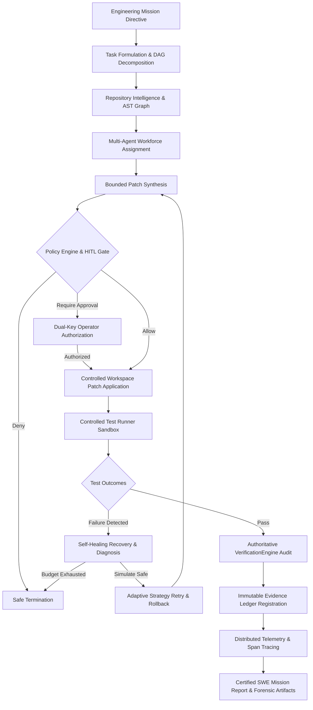

# ORION System Architecture Specification

**Release Version:** `10.0.0-rc1`  
**Architecture Status:** **FROZEN & RECONCILED**  
**Classification:** Autonomous AI Engineering Operating System  

---

## 1. System Overview & Core Philosophy

ORION is a production-grade, secure, deterministic, and evidence-backed Autonomous AI Engineering platform designed to solve software engineering tasks with complete transparency, bounded self-healing, and dual-key authorization.

The architecture eliminates "black-box" generative drift by subjecting all model proposals, repository operations, tool invocations, and test evaluations to strict, authoritative verification gates.

---

## 2. End-to-End Mission Pipeline (16 Stages)

1. **MISSION:** User or system initiates task directive with natural language objective and bounded workspace root path.
2. **UNDERSTANDING:** Intent analysis parses requirements and constraints into formal evaluation acceptance criteria.
3. **PLANNING:** Deterministic workflow stages and directed acyclic graph (DAG) tasks are assembled.
4. **REPOSITORY INTELLIGENCE:** AST static analysis parses repository topology, cross-file symbol call-graphs, and change blast radius.
5. **MULTI-AGENT WORKFORCE:** Specialized agents (SWE Engineer, Diagnostic Specialist, Authoritative Verifier, Recovery Coordinator) are assigned based on capability policies.
6. **PATCH GENERATION:** Bounded, unified diffs are formulated against impacted target files only.
7. **HUMAN OVERSIGHT:** Ambiguities prompt clarification requests; operators can pause, steer, or inspect diffs.
8. **CONTROLLED EXECUTION:** Workspace containment enforces strict filesystem boundaries; escapes are physically impossible.
9. **TESTING:** Subprocess pytest runs execute within timeout and memory sandboxes without shell access.
10. **VERIFICATION:** Independent `VerificationEngine` audits ground-truth criteria; test passing alone is insufficient.
11. **SELF-HEALING:** Failed executions are classified into formal taxonomies; simulated before application under a strict recovery budget.
12. **POLICY ENFORCEMENT:** Central `PolicyEngine` deterministically enforces security guardrails (`ALLOW`, `DENY`, `REQUIRE_APPROVAL`, `MODIFY`).
13. **EVALUATION:** Automated benchmark runner computes standardized metrics (Pass@1, recovery rate, latency quantiles).
14. **OBSERVABILITY:** Distributed tracer correlates spans across Mission &rarr; Task &rarr; Agent &rarr; Tool/Model &rarr; Verification with token costs.
15. **EVIDENCE:** Cryptographically hashed evidence records are appended to an immutable audit ledger.
16. **FINAL RESULT:** Certified, evidence-backed SWE mission report is exported in structured JSON and Markdown formats.

---

## 3. Subsystem Architecture

### 3.1 Core Missions & Lifecycle Engine (`orion.core.missions`)
- **Lifecycle States:** `CREATED` &rarr; `QUEUED` &rarr; `RUNNING` &rarr; `PAUSED` &rarr; `RECOVERING` &rarr; `COMPLETED` / `FAILED` / `CANCELLED` / `TERMINATED`.
- **Transitions:** Strict state machine rejects invalid transitions.
- **Engine Control:** Thread-safe execution engine supporting non-blocking pauses, resume, and cancellation.

### 3.2 Repository Intelligence & Graph Analysis (`orion.core.repository_intelligence`)
- **AST Parsing:** Multi-language abstract syntax tree extraction indexing functions, classes, imports, and definitions.
- **Dependency Graph:** Bi-directional graph tracking direct and transitive callers/callees.
- **Blast Radius Analyzer:** Calculates change impact score and identifies all affected test files.
- **Context Optimizer:** Builds minimal token-bounded context neighborhoods around target modification sites.

### 3.3 Multi-Agent Workforce (`orion.core.agents`, `orion.core.workforce`)
- **Specialist Roles:** SWE Implementer, Diagnostic Investigator, Authoritative Verifier, Recovery Coordinator.
- **Capability Profiles:** Granular permissions govern tool usage, filesystem mutations, and external calls.
- **Conflict Arbitration:** Multi-agent peer review and evidence-weighted resolution arbitrate competing patch proposals.

### 3.4 Tool Execution & Dual-Key Security (`orion.core.tools`, `orion.core.security`)
- **Tool Registry:** In-memory registry with strict schema definitions.
- **ApprovalService:** Authoritative dual-key approval authority. High-risk operations (e.g., `apply_patch`) require cryptographic single-use approval tokens. Replay attacks are cryptographically rejected.

### 3.5 Authoritative Verification (`orion.core.verification`)
- **Independent Authority:** `VerificationEngine` cannot be bypassed by client requests or language model outputs.
- **Acceptance Criteria:** Requires allowlisted exit code 0, complete assertion fulfillment, zero regression in existing test suites, and immutable evidence registration.

### 3.6 Adaptive Self-Healing & Recovery (`orion.core.recovery`)
- **Failure Taxonomy:** Diagnostic classifier maps errors into formal categories (syntax, assertion, type, import, timeout, security).
- **Simulation Engine:** Dry-run pre-execution verifies patch safety and blast radius before filesystem mutation.
- **Bounded Budget:** `RecoveryBudget` limits attempts ($\le 3$), execution time ($\le 120\text{s}$), and patch regenerations ($\le 2$). Clean rollback guarantees zero unverified mutations.

### 3.7 Central Policy Engine (`orion.core.policy`)
- **Rule Hierarchy:** Evaluates subject, action, resource pattern, risk tier, and environment.
- **Enforcement Actions:** `ALLOW`, `DENY`, `REQUIRE_APPROVAL`, `MODIFY` (sanitization).
- **Integration:** Directly wired into `ToolExecutor.execute()`. Any denied action halts execution immediately.

### 3.8 Observability & Distributed Tracing (`orion.core.observability`)
- **Correlated Hierarchy:** Mission &rarr; Task &rarr; Agent &rarr; Tool/Model &rarr; Test &rarr; Verification.
- **Metrics:** Latency quantiles ($P_{50}, P_{90}, P_{99}$), prompt tokens, completion tokens, cost estimation.
- **Optimization:** Automated heuristic analyzer highlights execution bottlenecks and token reduction insights.

### 3.9 Evidence Ledger & Provenance (`orion.core.swe.evidence`)
- **Ledger Model:** Append-only cryptographic ledger tracking Claimed, Observed, and Verified evidence.
- **Forensic Inspectability:** Every code change, test output, diagnosis, and verification decision is permanently traceable.

---

## 4. Execution Boundary & Distributed Decision (ADR-001)

As documented in `docs/ORION_DISTRIBUTED_EXECUTION_ARCHITECTURE_DECISION.md`, ORION V10 formally adopts **Option A: Hardened Single-Node Multi-Threaded Architecture with Container-Level Horizontal Scalability**.

- Multi-threaded execution in a single Python 3.12 process.
- No synthetic or pseudo-distributed clustering claims.
- Horizontal scaling is achieved by deploying stateless container replicas behind an external reverse proxy (e.g. NGINX, Kubernetes ingress).
- Multi-node distributed queue clustering (Redis/Kafka) is explicitly designated as future infrastructure.

---

## 5. Security & Zero-Trust Invariants

ORION operates on the principle that the client frontend, language model output, and repository contents are wholly untrusted. Security controls are deterministic and non-negotiable.

Refer to `docs/ORION_V10_SECURITY_AUDIT.md` for full penetration testing details.
